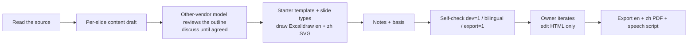

# Slide: build a deck from a source text

For agents making slides for Whisker. Visual and motion rules (tokens, sizes, slide types, components, Excalidraw drawing, starter template) are in [references/style.md](references/style.md) and are not repeated here. This file says **how to work**: inputs, flow, folders, past corrections, delivery checks.

**Sync rule:** the repo copy is for agents, Notion ("Slide" and "slide 风格" pages) is for humans. When one changes, update the other and add a CHANGELOG bullet.

## 1. Inputs

| Input | Note |
| --- | --- |
| Source text | What the talk draws from: a research report, an mdx document, a design draft |
| One-line topic | The cover title, for example "From asset supply to sustainable trading, and product-driven chain infra" |
| Audience and length | Decides the slide count and depth |
| Theme | Work (Mantle) decks use the Mantle theme; colours and fonts do not change. Personal decks use the Personal theme |
| Material | Screenshots, data (with source and time window), existing figures |

## 2. Flow



### 2.1 Write the per-slide content draft first. Do not draw first.

One Markdown file per section (`design/sections/NN-<name>.md`). Each slide answers four things:

1. **What the slide says:** one conclusion sentence; which part of the source it comes from.
2. **What goes on the slide:** what the figure and text are, **what the note needs and why**; do not draw it in this step. Pick a slide type (style.md section 5).
3. **Copy:** the exact text of eyebrow, title, sub, cards and takeaway. Short and exact. This is the most important step.
4. **Humanize:** the audience must get it on first hearing. An uncertain number does not go on the slide; it goes into the notes' "basis".

Send the draft to a model from another vendor for review (the Notion design uses GPT-6 Astra) and discuss until you agree, then build the HTML. A slide with more than 3 groups of information becomes a two-step slide or two slides.

### 2.2 Build

- Copy `assets/deck-template.html` (style.md section 10). It already has paging, entrance, two-step slides, export, overflow check, language toggle and notes panel. Replace only the content; do not invent layouts.
- One `diagrams/pXX-name.mjs` skeleton per figure; render it with `render.mjs` into `pXX-name.svg` and `pXX-name.zh.svg`.
- Slide 0 is the cover: the topic of this talk.

`render.mjs` prerequisites:

- Node.js >= 20.
- `npm i puppeteer-core` in the deck directory (put `render.mjs` and `lib.mjs` in `diagrams/`; Node finds `node_modules` upward).
- `CHROME_PATH` set to the local Chrome executable, for example `/Applications/Google Chrome.app/Contents/MacOS/Google Chrome`.
- Network access: the page loads `@excalidraw/excalidraw@0.18.0` from esm.sh.

```bash
cd slides/diagrams
npm i puppeteer-core
CHROME_PATH="/Applications/Google Chrome.app/Contents/MacOS/Google Chrome" node render.mjs p01-example.mjs
# -> p01-example.svg and p01-example.zh.svg
```

`assets/examples/p01-example.mjs` is a working figure skeleton. It imports `../lib.mjs`; inside a deck, `pXX` files sit next to `lib.mjs` and import `./lib.mjs`.

### 2.3 Notes and speech script

- Each slide's hidden notes have two parts, "notes" and "basis" (data source, time window, what must not be said).
- When a full speech script is needed, write it to `outputs/script.md`: give the audience the background and context they need, and cover the whole flow.

### 2.4 Iterate

- In the discussion phase edit only the HTML. Do not re-export or rewrite the draft every time.
- Handle the owner's screenshot feedback one item at a time; after each fix, recheck that slide with `?dev=1` and the language toggle.

## 3. Folder layout

```txt
slides/
  deck.html                 # single-file deck (the starter template)
  diagrams/                 # lib.mjs, render.mjs, pXX-*.mjs and the rendered .svg / .zh.svg
  assets/                   # screenshots (keep original colours)
  design/sections/          # per-slide content drafts
  references/               # source text
  outputs/                  # deck-en.pdf, deck-zh.pdf, script.md, png/en|zh/
```

## 4. Past corrections (read before you start)

From the mantlev3-roadmap and research-deck sessions.

| Problem | Correct way |
| --- | --- |
| A footnote line at the bottom of every slide | Do not. Put the basis in the notes; the slide keeps only the Source line at bottom left |
| Page number at top right | Bottom right, in a lighter colour |
| Only one language | One-key Chinese / English toggle (L key); figures need both languages too |
| Flat figure | Layer it: main flow on the upper layer, add-on products interleaved on the lower layer; the problem they solve goes on the right, not below |
| Hover swap of an image flickers (the new image triggers the hover again) | Stay switched, no revert, and lock with a debounce (style.md 8.5) |
| Screenshot not aligned | Align screenshots with cards; overlay a highlight box on the key spot |
| Too much on one slide | Split into a two-step slide or two slides |
| Status slide gives time estimates | State status only; mark done with a tick and a date |
| Invented terms (such as "subblocks" for flashblocks) | Use the project's official names |
| Draw first, think about copy later | Write the per-slide draft first (2.1) |

## 5. Delivery checklist

The checklist in style.md section 12 applies, plus two more:

- [ ] Every line of slide copy has a source in the content draft.
- [ ] None of the problems in section 4 appears.

## 6. Coverage of the ten common content rules

The ten rules come from the Notion page "内容输出模板" §2 (shared by research posts and slides).

| # | Rule | In a slide |
| --- | --- | --- |
| 1 | Conclusion first | Applies: h1 is a conclusion, sub says what to look at, the takeaway is a quotable sentence (style.md section 11) |
| 2 | Onboarding before depth | Applies with a change: the audience and length decide depth; the cover and the per-slide draft set the order; no prerequisite cards |
| 3 | Every fact traces to a source | Applies: Source line at bottom left, full basis in the notes; an uncertain number stays off the slide |
| 4 | A figure beats words | Applies: Excalidraw per figure, layered (main flow above, add-ons below), problem on the right; simple chains use HTML cards |
| 5 | Humanize, keep it technical | Applies: short copy, no footnote on every slide, layout speaks for itself |
| 6 | Chinese and English | Applies: `data-zh` text and `.zh.svg` figures, L key toggle, same meaning, not word for word. Tweet cards do not apply (research posts only) |
| 7 | Work private, Mantle colours; personal colours for personal | Applies: Mantle theme for work decks (colours and fonts fixed), Personal theme otherwise |
| 8 | Cross-vendor review | Applies to the outline: another vendor's model reviews it before the HTML is built. The finished deck follows the self-check list |
| 9 | Self-check before delivery | Applies: `?dev=1` shows no red slide, language toggle shows no overflow, `?export=1` PDFs checked (style.md section 12). Phone screenshots do not apply: a deck is 1920×1080 |
| 10 | Discussion phase edits only the draft | Applies: edit only the HTML while discussing; no re-export or re-write of the draft each time (2.4) |
